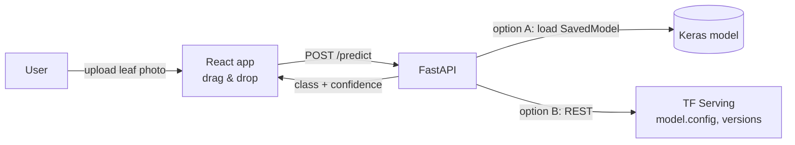

<div align="center">


# Plant Disease Classifier

**Snap a leaf, get a diagnosis. CNN models for potato and tomato leaf diseases, served by a FastAPI backend and a React web app.**


</div>

---

## Overview

Farmers lose a large share of their crops to leaf diseases that are easy to spot early, if you know what to look for. This project trains CNNs on the **PlantVillage** dataset and wraps them in an end-to-end app: **training → model versioning → REST API → web UI**.

| Crop | Classes | Images | Test accuracy |
|---|---|---|---|
| 🥔 **Potato** | Early blight · Late blight · Healthy | 2,152 | **91.8 %** |
| 🍅 **Tomato** | 10: bacterial spot, early and late blight, leaf mold, septoria, spider mites, target spot, yellow-leaf-curl virus, mosaic virus, healthy | 16,011 | **95.8 %** |

## Architecture



## Model

- **Input**: 256×256 RGB leaf image.
- **Preprocessing layers** inside the model: resize, rescale and **data augmentation** (random flip and rotation), so the API can send raw images.
- **CNN**: stacked `Conv2D` + `MaxPooling` blocks → `Dense` → softmax.
- **Split**: 80 / 10 / 10 train / val / test, with `cache()` + `prefetch()` for fast `tf.data` pipelines.
- **Versioning**: models are saved as `models/<version>` so **TF Serving** can serve several versions side by side ([`model.config`](potato/model.config)).

## Project structure

```text
plant-disease-classifier/
├── potato/
│   ├── training/potato_training.ipynb   # data pipeline, CNN, evaluation, export
│   ├── api/
│   │   ├── main.py                      # FastAPI, loads the SavedModel directly
│   │   └── main-tf-serving.py           # FastAPI, proxies to TF Serving
│   ├── model.config                     # TF Serving multi-version config
│   └── frontend/                        # React + Material-UI drag-and-drop UI
└── tomato/
    └── training/tomato_training.ipynb   # 10-class tomato model
```

## Run it

### 1. Model

📦 **The trained models will be uploaded to Google Drive soon, and the download link will be added here.**
Until then, run the training notebook. It saves the model to `potato/models/1`.

Dataset: [PlantVillage on Kaggle](https://www.kaggle.com/datasets/arjuntejaswi/plant-village). Put it in `potato/Dataset/archive/PlantVillage`.

### 2. API

```bash
cd potato/api
pip install fastapi uvicorn tensorflow pillow numpy python-multipart
python main.py                 # http://localhost:8000/docs
```

<details>
<summary>Or serve with TF Serving</summary>

```bash
docker run -p 8501:8501 -v "$(pwd)/potato:/DL_Project_Potato_Disease" tensorflow/serving \
  --model_config_file=/DL_Project_Potato_Disease/model.config
python potato/api/main-tf-serving.py
```
</details>

### 3. Web app

```bash
cd potato/frontend
cp .env.example .env           # REACT_APP_API_URL=http://localhost:8000/predict
npm install
npm start                      # http://localhost:3000
```

## Credits

The potato project, including its React frontend, was built by following the excellent **[codebasics](https://github.com/codebasics) Potato Disease Classification** deep-learning series. I then applied the same pipeline to the **10-class tomato** dataset myself.

## What I learned

- Building `tf.data` pipelines with augmentation baked into the model.
- Deploying a model behind **FastAPI**, and serving versioned models with **TF Serving**.
- Connecting a React front end to an ML backend (CORS, multipart uploads).

## Author

**Humam Al-Dhubhani** · [GitHub](https://github.com/humamaldhubhani)

<sub>Released under the [MIT License](LICENSE). PlantVillage images are not redistributed here.</sub>
